<p align="center"></p>

# braze-lifecycle-kit

Open-source lifecycle program blueprints for Braze. Twelve retention and lifecycle programs (welcome, cart and browse abandonment, post-purchase, winback, sunset, and more), each written as a strategy brief, a click-by-click canvas build recipe, and drop-in Liquid. A shared library holds the naming taxonomy, segment recipes, QA and deliverability checklists, and a measurement framework. A Claude Code skill pack lets an AI agent draft new programs, audit canvas builds, and review Liquid against the same standards.

This project is unofficial. It is not affiliated with, endorsed by, or sponsored by Braze, Inc. "Braze" is a trademark of its owner and is used here only to describe compatibility. All examples use a fictional retailer, Northwind Supply Co., and `example.com` URLs.

## Why recipes, not JSON

Braze's REST API can export Canvas metadata and analytics (`/canvas/list`, `/canvas/details`, `/canvas/data_summary`) and can create and update email content blocks (`/content_blocks/create`). It cannot export a Canvas's step structure as a portable definition, and it cannot import a Canvas from JSON. There is no click-to-deploy path for a Canvas.

So this kit does not ship deployable JSON, and nothing in it pretends to. Every program ships as:

1. A **build recipe** (`BUILD.md`): numbered steps a marketer follows in the Canvas editor, with exact entry filters, delays, splits, exit criteria, and send settings.
2. **Copy-pasteable code** (`snippets.liquid`): Liquid for every message step, each block with fallbacks and failure handling.
3. **Checklists**: program-specific QA additions on top of the shared library checklists.

A recipe takes 30 to 90 minutes to build by hand. That is slower than an import, and it has one real upside: the person building the Canvas reads every setting before it goes live.

## Directory map

```
braze-lifecycle-kit/
├── README.md                    You are here
├── LICENSE                      MIT
├── CONTRIBUTING.md              How to add or improve a program
├── programs/
│   ├── _TEMPLATE.md             Skeleton for a new program
│   └── NN-<program>/
│       ├── PROGRAM.md           Strategy: goal, logic, entry, audience, message map, guardrails, measurement
│       ├── BUILD.md             Canvas construction recipe + program-specific QA
│       └── snippets.liquid      Drop-in Liquid for each message step
├── library/
│   ├── naming-taxonomy.md       Names for canvases, messages, segments, content blocks, tags, events
│   ├── liquid-snippets.md       Defensive Liquid patterns and anti-patterns
│   ├── segment-recipes.md       Reusable segment definitions
│   ├── qa-checklist.md          Pre-launch QA for any canvas
│   ├── deliverability-checklist.md  Authentication, warming, thresholds
│   └── measurement-framework.md KPI hierarchy, holdouts, attribution, reporting
└── skills/
    ├── braze-program-architect/SKILL.md
    ├── braze-canvas-qa-auditor/SKILL.md
    └── braze-liquid-reviewer/SKILL.md
```

## The twelve programs

| # | Program | Entry | Primary KPI | Status |
|---|---|---|---|---|
| 01 | [Welcome / Onboarding](programs/01-welcome-onboarding/PROGRAM.md) | Action: `signed_up` or `email_subscribed` | 30-day first-purchase rate | ✅ Complete |
| 02 | [Double Opt-In](programs/02-double-opt-in/PROGRAM.md) | Action: `email_subscribed`, then confirmation click | Confirmation rate | ✅ Complete |
| 03 | [Browse Abandonment](programs/03-browse-abandonment/PROGRAM.md) | Action: `product_viewed` | 14-day browse-to-purchase rate | ✅ Complete |
| 04 | [Cart Abandonment](programs/04-cart-abandonment/PROGRAM.md) | Action: `added_to_cart` | 7-day cart recovery rate | ✅ Complete |
| 05 | [Post-Purchase](programs/05-post-purchase/PROGRAM.md) | Action: `purchase` | 90-day repeat purchase rate | ✅ Complete |
| 06 | [Winback](programs/06-winback/PROGRAM.md) | Scheduled: `lapsed-90-180d` | Reactivation rate vs holdout | 📝 Planned |
| 07 | [Churn Prevention](programs/07-churn-prevention/PROGRAM.md) | Action: `subscription_cancel_initiated` | Save rate | 📝 Planned |
| 08 | [Sunset Cleanup](programs/08-sunset-cleanup/PROGRAM.md) | Scheduled weekly: `unengaged-180d` | Inbox placement delta | 📝 Planned |
| 09 | [Back-in-Stock + Price Drop](programs/09-back-in-stock-price-drop/PROGRAM.md) | Action: `back_in_stock_signup`, price-drop events | Notify-to-purchase rate | 📝 Planned |
| 10 | [Loyalty / Referral](programs/10-loyalty-referral/PROGRAM.md) | Action: post-purchase, tier and points events | Referred first purchases | 📝 Planned |
| 11 | [Anniversary / Milestone](programs/11-anniversary-milestone/PROGRAM.md) | Scheduled daily | Sentiment (reply/CSAT) | 📝 Planned |
| 12 | [Re-permissioning](programs/12-repermissioning/PROGRAM.md) | Scheduled quarterly + footer link | Unsubscribe-rate delta | 📝 Planned |

✅ Complete = `PROGRAM.md`, `BUILD.md`, and `snippets.liquid`. 📝 Planned = `PROGRAM.md` strategy brief only; contributions welcome.

### How the programs fit together

Programs 03, 04, and 05 compete for the same shopper on the same day. The kit resolves that on purpose: cart abandonment outranks browse abandonment (browse waits four hours and exits on `added_to_cart`), and a `purchase` event ends both and starts post-purchase. Program 02 feeds program 01: welcome starts only after the subscriber confirms. Program 08 (sunset) protects the sender reputation that every other program depends on, so run it before you scale anything else.

## How to use

1. **Steal the strategy.** Read the program's `PROGRAM.md`. Adjust timing, channels, and incentive depth to your margin and your data. Decide the primary KPI before you build anything.
2. **Build the canvas.** Follow `BUILD.md` step by step in the Braze Canvas editor. Name everything with [`library/naming-taxonomy.md`](library/naming-taxonomy.md). Create the segments you need from [`library/segment-recipes.md`](library/segment-recipes.md) first.
3. **Copy the code.** Paste the matching block from `snippets.liquid` into each message step. Swap Northwind's placeholder URLs, promotion code list identifiers, and content block names for your own.
4. **QA.** Run [`library/qa-checklist.md`](library/qa-checklist.md), the program's QA additions at the bottom of `BUILD.md`, and, for any new sending volume, [`library/deliverability-checklist.md`](library/deliverability-checklist.md). Send real trigger events through a test user. Previews alone are not QA.
5. **Measure.** Keep the 10% control group. Report against [`library/measurement-framework.md`](library/measurement-framework.md): incremental lift over control on the primary KPI, with guardrails (unsubscribe under 0.3% per send, complaints under 0.1% per send) checked every send.

## For AI agents

The `skills/` folder is a Claude Code skill pack. Copy a skill folder into `.claude/skills/` in your project (or `~/.claude/skills/` for all projects) and the agent loads it when the task matches. Each skill points at the library files rather than duplicating them, so updating a checklist updates every skill that uses it.

| Skill | What it does |
|---|---|
| [`braze-program-architect`](skills/braze-program-architect/SKILL.md) | Drafts a new program folder (`PROGRAM.md`, `BUILD.md`, `snippets.liquid`) from the template: clarifies goal, trigger, channels, and incentive margin, checks overlap with existing programs, then self-reviews against the QA and deliverability checklists. |
| [`braze-canvas-qa-auditor`](skills/braze-canvas-qa-auditor/SKILL.md) | Audits a described canvas build item by item against the QA checklist and cross-program conflicts, and returns 🔴 blockers, 🟡 risks, and 🟢 passes with a GO / GO WITH FIXES / NO-GO verdict. |
| [`braze-liquid-reviewer`](skills/braze-liquid-reviewer/SKILL.md) | Reviews Braze Liquid for missing fallbacks, unsafe Connected Content, event properties in scheduled sends, whitespace and encoding bugs, and logic errors. Returns fixed snippets and an APPROVED / NEEDS CHANGES verdict. |

## Assumptions and caveats

- Liquid syntax targets current Braze Canvas (the Canvas Flow editor). Canvas entry properties are referenced as `{{canvas_entry_properties.${name}}}`; see [`library/liquid-snippets.md`](library/liquid-snippets.md) for when `event_properties` applies instead. Braze ships editor changes often, so confirm menu names against your dashboard.
- Benchmarks and targets in this kit are starting hypotheses for planning, not promises. Your control group is the only number that matters.
- Compliance notes (consent, SMS, unsubscribe handling) are operational checklists, not legal advice. Confirm requirements for your jurisdictions with counsel.

## Contributing

Read [CONTRIBUTING.md](CONTRIBUTING.md). The short version: copy the template, fill every section, use fictional data, follow the taxonomy, and self-QA before you open a pull request. The seven planned programs are the best place to start.

## License

[MIT](LICENSE). Copyright (c) 2026 Andrew Luxem.
